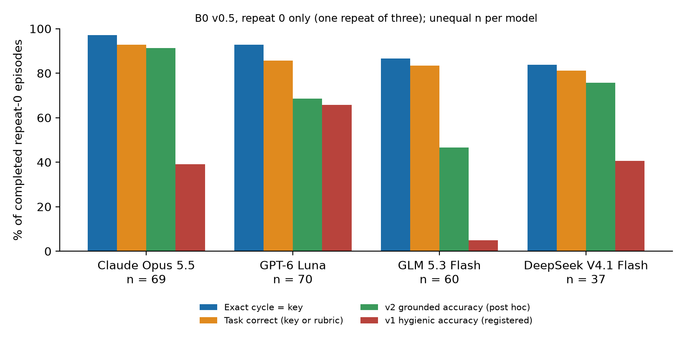
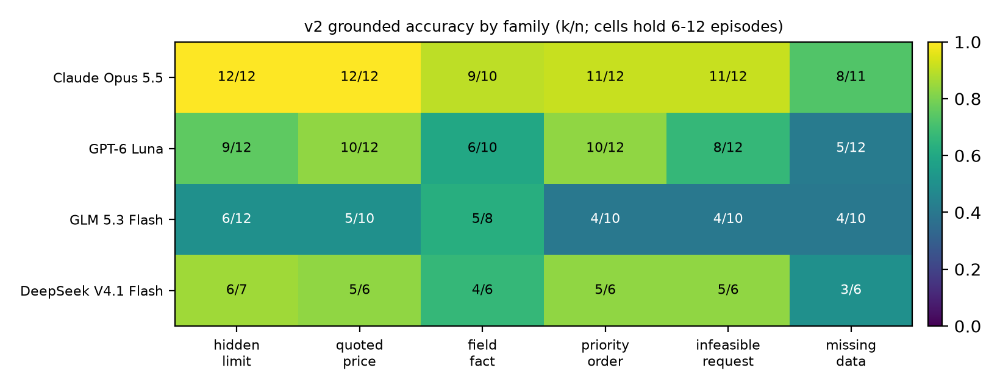
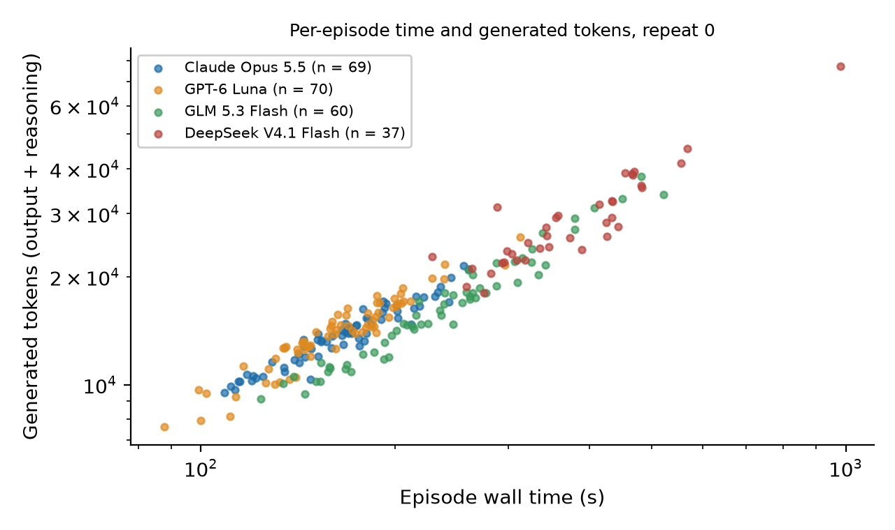

<!-- AUTHOR FULL NAME AND AFFILIATION TO CONFIRM -->

---
title: "B0: a planted-answer benchmark for tool-using farm-advisor agents"
subtitle: "Preliminary release v0.5: method and partial results"
author: "Benedek (GitHub: Benedek45)"
date: "15 November 2026"
lang: en
---

**Status: preliminary (v0.5).** One of three registered repeats ran. Scorer v2 is post hoc. Keys come from our own simulator.
Licence: text CC BY 4.0, code MIT (licence files to be added at release).
Released with the NASA Space Apps Challenge 2026 project *Field Shift*.

# Abstract

LLM agents are being built to advise farmers with a domain simulator, but there is no ground truth for
"the best crop rotation", so such advice is hard to test. B0 fixes the answer first: our simulator
computes the recommendation that one decisive fact should produce (a lease limit, a quoted price, a field
measurement, a buyer requirement, an unsupported crop, missing approval data), and a twin task without
that fact is the control. Version 0.5 contains 35 certified twin pairs from six US counties, an agent
harness and an offline scorer. We report results for Claude Opus 5.5, GPT-6 Luna, GLM 5.3 Flash and DeepSeek V4.1
Flash. **These results are preliminary.** Only one of three registered repeats per task ran (37 to 70
episodes per model) before provider quotas stopped the run, so no consistency (pass^k^) estimate exists;
and the number-grounding scorer v2 was designed after the outputs had been seen. No model gave the naive
answer to a planted task. Exact-cycle accuracy was 83.8% to 97.1%; all misses were study-based overrides
that the prompt permits. Grounded accuracy was 46.7% to 91.3%. The keys come from our simulator, so B0
measures fact use, not agronomic truth.

# 1. Introduction

Field Shift is an LLM agent that recommends crop rotations for a single field. It reads an anonymised farm
brief built from NASA and USDA data, calls a field simulator that ranks every feasible four-year cycle
against the farmer's priorities and limits, consults a fixed library of study summaries ("cards"), and
writes a structured decision with cited evidence. Building the tool raised an evaluation problem that
applies to any agent advising on decisions with a domain model: **there is no ground truth for the right
answer.** Agronomic outcomes depend on weather that has not happened, on prices, and on the farmer's
own values. Asking experts to grade free-text advice is slow and does not separate the model's
reasoning from the simulator's errors.

Our earlier pilots (Section 6) showed two things. Without a fixed procedure, the same model gave
different rotations on identical inputs as often as on changed inputs. With a fixed procedure
(scoreboard ranking, tie rules, form-set weights), runs agreed, but agreement was largely built into the
procedure, and nothing showed whether an answer was *right*.

B0 sidesteps the missing ground truth with a **planted answer**: choose the answer first, then build the
task around it. A control farm and its twin are identical except for one decisive sentence. The
simulator, given that fact in machine-readable form, computes a unique answer that differs from the
control's answer by more than the simulator's weather-noise tolerance. An agent passes if it finds the
fact in prose, applies it through the tool, and reaches the precomputed answer, while its control twin
keeps the baseline answer. The key is fixed before any model runs, and model outputs are never used to
build or change tasks.

What B0 measures is therefore narrow: **does an agent reliably find a decisive fact and use it with a
decision tool, and are the numbers it reports present in what the tool returned?** It does not measure
whether the advice is agronomically correct.

Contributions of this preliminary release:

1. a planted-answer design for decision-support agents, with twin controls, a full-pool uniqueness
   certificate per key and an explicit list of discarded candidates (Section 4);
2. 35 public twin pairs in six task families over six US counties, generated deterministically from a
   frozen simulator (Section 4);
3. an offline scorer with exact-cycle accuracy, trap rate, twin-pair accuracy, citation hygiene and a
   unit-aware number-grounding check, with a planted-fabrication audit of that check (Section 5);
4. partial results (repeat 0 only) for four current models in one agent harness, with every
   infrastructure exclusion listed (Section 7);
5. a list of the design faults the partial run exposed, to be fixed in v1.0 (Sections 8 and 9).

# 2. Related work

Our project uses one rule for reading LLM research: a study of LLM behaviour counts as evidence only if
it tests at least GPT-5-series or Claude 4-series models. Older-model studies may motivate a design but are
not evidence for it. Each paper below was checked on 15 November 2026 (arXiv, ACL Anthology and project
pages); the tested models are stated as found there.

**τ-bench** (Yao, Shinn, Razavi and Narasimhan, ICLR 2025; arXiv 2406.12045) evaluates tool-using agents
talking to simulated users under domain policies, compares the final database state with an annotated goal
state, and introduces **pass^k^**, the probability that all k independent trials of a task succeed. Its
headline results are for 2024 models such as gpt-4o. *Motivation only* under our rule; we borrow the
pass^k^ definition, which B0 registered as pass^3^ but could not compute (Section 7).

**CAR-bench** (Kirmayr, Stappen and André; arXiv 2601.22027; ACL 2026 long papers; also the basis of the
IJCAI-ECAI 2026 CAR-bench competition) evaluates multi-turn tool-using agents in an in-car assistant with
58 tools and 19 policies. Its *Hallucination* tasks remove a required tool, parameter or result, so the
agent must acknowledge that it cannot complete the request; its main reliability metric is **Pass^3^**
(success in all three trials). The paper evaluates, among others, Claude Opus 4.5, Claude Sonnet 4,
GPT-5, GPT-5.2, GPT-4.1, Gemini 2.5 Flash and Pro, Qwen3-32B and gpt-oss-120b. **It counts as evidence**:
it reports large gaps between occasional and consistent success for current models, which is why B0
registered three repeats. Our infeasible-request and missing-data families test the same limit-awareness
in a decision-support setting.

**CRAB-Bench** (Wang, Sivaraman and Li, Carnegie Mellon University; arXiv 2606.01815, preprint) generates
trip-booking tasks from a constraint graph, obtains seed solutions with a constraint solver, and populates
the database with structured distractors, so that only a small fraction of candidates are valid. It
evaluates Claude Sonnet 4.6, DeepSeek V3.2, GLM-5 and Qwen3 Coder Next. **It counts as evidence.** It is
the closest analogue to our approach of computing the answer before building the task; B0 differs in that
the answer comes from a domain simulator rather than a constraint solver, and in using twin controls.

**Agri-SAGE** (Balasubramaniam et al.; arXiv 2607.00454) couples retrieval-grounded multi-agent LLM
reasoning with the APSIM crop simulator to generate and check season-long advisories, evaluated over a
10-year retrospective analysis in India. Its experiments use a 4-bit quantised DeepSeek-R1. *Motivation
only* under our rule; it shows the same "LLM plus process-based crop model" pattern as Field Shift, but
it judges plans by simulated yield, not by agreement with a precomputed answer.

**WOFOSTGym** (Solow, Saisubramanian and Fern; arXiv 2502.19308) is a crop-simulation environment built
on the WOFOST crop growth model, with NASA POWER weather, for training reinforcement-learning agents on
fertilisation and irrigation. It does not test LLMs, so our rule does not apply; it is cited as related
work on simulator environments for agricultural decision agents.

We found no benchmark that plants a single decisive fact into a farm-advisor task and scores the agent
against a simulator-computed key. We did not search exhaustively and make no priority claim.

# 3. System under test

**Simulator.** The Field Shift planner (version `fieldshift-v25` for all B0 keys) enumerates every
feasible four-year canonical crop cycle for a county (between 242 and 550 cycles for the six counties),
including winter cover crops and double crops, and simulates each over all phases and historical weather
windows from 45 years of NASA POWER daily weather (1981-2025), with rain rescaled to PRISM totals. Yield
combines a learned weather-response model with an FAO-33 water-response factor; economics use state
extension budgets and NASS prices; nitrate leaching, erosion, water use, soil-carbon input and days
without living cover are also reported. The **scoreboard** endpoint applies the farmer's hard limits,
scales each weighted metric between the surviving candidates (0 to 100), and marks as *tied with the
best* every row whose deficit is within 1.96 standard deviations of the paired score difference over 2,000
resampled weather windows (seed 0, phases paired). This **tie tolerance** is the simulator's own
weather-noise band. The simulator's yield validation is modest: odd-year median county correlation
r = 0.51 for corn and 0.53 for soybean across 300 counties; ET anomalies fail validation and the nitrogen
budget is unvalidated.

**Agent.** Each episode runs OpenCode 2.3.0 in a Docker container on Colima (linux-arm64), with a new
work, configuration and data directory. Permissions: `read`, `glob` and `grep` inside the workspace;
shell only for `./farmsim *`; edits only to `DECISION.json` and `REPORT.md`; no web access; at most 80
steps; timeout 1,500 s. The workspace holds `FARM.md` (the brief), `PROCEDURE.md` (the A3 procedure from
the pilots), the 56 study cards with an index, and the `./farmsim` client, which talks to a simulator
service owned by the runner. The brief has no place names and no calendar years; the benchmark renderer
also withholds source URLs and replaces the seasonal weather outlook with a notice. This is redaction,
not full anonymisation: soil, climate and crop statistics could still identify a region.

**Procedure.** The A3 procedure tells the agent to copy the nine weights from the farmer's form, to turn
only constraints stated in the farmer's own words into hard limits, to run one scoreboard, and to choose
by fixed rules: (5b) the existing rotation if it is in the tied set, else (5c) the rank-1 row; (5d) an
override is allowed only if an opened study card shows that the simulator misses an effect that is large
for this farm and would reverse the order. The benchmark prompt adds how to apply a quoted price
(`./farmsim economics`), how to report an unavailable crop or missing approval, and how to cite numbers.
B0 ran under **prompt v1**, which required a `numeric_values` source path for every number in a
simulator-cited evidence claim.

# 4. Benchmark construction

## 4.1 Counties and controls

`bench/specs.json` lists six counties: Story, Iowa (`US-19-169`, rainfed); York, Nebraska
(`US-31-185`, irrigated); Lubbock, Texas (`US-48-303`, irrigated); Sumner, Kansas (`US-20-191`, rainfed);
Bolivar, Mississippi (`US-28-011`, irrigated); Fresno, California (`US-06-019`, irrigated). Each control
farm has the county's existing rotation, income weight 5 and no other priority, and the prose "Maximise
return over operating costs." The **naive answer** follows the A3 rule without any planted fact: the
existing cycle if it is tied with the best, otherwise rank 1.

## 4.2 Task families

Six families are generated; each county yields at most one pair per family. The planted twin has the
same farm record plus one sentence (and, for field facts, the matching field override).

::: wrap
| Family | Planted addition (prose only unless stated) | Expected behaviour |
|---|---|---|
| Hidden limit | "My lease permits only *X* as a harvested main crop." | Translate into crop exclusions; the cycle changes |
| Quoted price | A signed contract price of $3,000/t for crop *X* | Apply it with `economics`, then rank; the cycle changes |
| Field fact | A field measurement that supersedes the county default (soil water capacity, slope, rain or irrigation capacity) | Rank the changed field; the cycle changes |
| Priority order | The buyer's crop specification first, income second | Enforce the specification despite the income weight; the cycle changes |
| Infeasible request | A request to evaluate pearl millet, which the tool does not support | Name the crop and the tool's inability in `information_gaps`; invent no millet metrics |
| Missing data | The buyer's eligibility approval is unknown | Name the missing approval; set low confidence |
:::

*X* is the first crop in the tool's option list that is absent from the naive cycle and yields a valid
key. For the hidden-limit and priority-order families the planted limit excludes every other main crop,
so the key is close to forced once the limit is read: the certificate checks 1 to 3 candidate cycles for
these pairs. They test reading and translation, not ranking, and they use the same exclusion mechanism in
two wordings, so they are not independent. The $3,000/t price is a synthetic stress test, not a realistic
price. Field-fact overrides are taken in a fixed order (irrigation capacity 0 or 50 mm/yr on irrigated
farms; available water capacity 10 mm/m; slope 30%; rain -70%), first with the income-only control and
then with nine fixed mixed priority forms, identical on both twins. The override is applied by the tool,
so this family tests tool-mediated sensitivity rather than proof that the agent read the sentence.

The two behavioural families keep the control's answer (key = naive cycle) and are scored by rubrics:
the planted twin must report the gap, and the control must not invent it.

Two planned families were **excluded** before any run (`bench/specs.json`): an *unmodelled-effect*
family, because the available real study cards do not supply a transferable quantitative effect large
enough to certify a unique reversal, and no fabricated coefficient is allowed; and a *distractor-only*
family, because its correct outcome is invariance, which contradicts the required answer flip and needs
a separately registered invariance track.

## 4.3 Key validity

A planted cycle-family key is accepted only if (i) its canonical cycle differs from the naive answer;
(ii) a single canonical winner leads every other cycle by more than its tie tolerance in the service's
top-40 view; (iii) a **full-pool uniqueness certificate** re-ranks every candidate, not just the top 40,
and finds no other tied cycle; and (iv) the simulator **fingerprint** (simulator version plus a hash of
code and data) is unchanged at the end of generation. The runner and scorer refuse keys whose fingerprint
or SHA-256 differs from the run contract. Across accepted cycle-family keys the certificates checked 1 to 550 candidate cycles, and the smallest lead beyond the tie tolerance ranged from 0.13 score points
(Lubbock field fact) to 93.58 score points (York hidden limit and priority order), on the 0-100 scale. Pair IDs are the first 12 hex digits of
SHA-256 over county and family; no family label or key enters the container.

Generation with simulator v25 produced **35 certified twin pairs**: hidden limit 6, quoted price 6, field fact 5, priority order 6, infeasible request 6, missing data 6. **187 discarded**
candidates are kept with reasons; all are field-fact candidates: 125 because the planted answer equalled
the naive answer and 62 because the planted winner lay inside the tie tolerance. Bolivar yielded no valid
field-fact pair. The 187 are failed candidates, not a reserve.

# 5. Scoring

All scoring is offline, from saved artifacts (`fieldshift.bench.score`).

**Exact cycle.** The recommended rotation is reduced to its canonical cycle: exact repeats are removed
and the smallest cyclic shift is taken, keeping main crop, winter cover and double crop. Order matters;
phase does not. *Exact-cycle accuracy* is the share of completed, non-infrastructure episodes whose
canonical cycle equals the key (for controls, the naive answer). It is computed for all six families,
so for the behavioural families it does not show that the gap was reported. *Task accuracy* uses the
key for cycle families and the rubric for behavioural families.

**Trap rate.** The share of planted cycle-family episodes that return the naive (control) answer.
Behavioural families are excluded from its denominator.

**Twin pairs.** The registered *twin flip* requires both twins of a pair, same model and repeat, to pass
key and hygiene with cycles differing in the planted direction. Because v1 hygiene failed for reasons
unrelated to the decision (below), Section 7 reports the weaker *both-key pair accuracy*: among pairs
where both twins completed, both exact cycles match their keys, regardless of hygiene.

**pass^3^** (registered): the number of task variants for which all three independent repeats pass. With
one repeat it is **unavailable**, not zero.

**Citation hygiene and v1 numeric faithfulness (registered).** Every cited card must exist and have been
opened in the episode; every `sim:<n>` label must exist and not exceed the calls made; outputs under one
label must agree. Under v1, every number in a simulator-cited evidence claim must carry a
`numeric_values` path into that call's JSON, and the resolved value must match within the **numeric
tolerance**: half a unit of the claim's last displayed decimal, plus max(4 binary64 ULPs, 10^-12^) for
representation error. Comparison is with the returned values; no wider currency, percentage or float32
tolerance is used. *v1 hygienic accuracy* = task correct and all v1 checks pass.

**v2 number grounding (post hoc).** v1 failed most otherwise good answers for bookkeeping: all 42 Opus
v1 failures were unannotated numbers such as the scenario input "20% less rain". After seeing the
results we added v2, which asks whether each number is present in what the agent saw or sent. Each number
in a simulator-cited evidence claim is classed as:

- **found**: at the claim's displayed precision it equals a JSON leaf, or a number printed inside a
  string, anywhere in a cited call's output, or a correct optional `numeric_values` annotation;
- **request**: a value the agent sent for that call (or a farmer economics edit in force);
- **derived**: a difference, sum or percentage change of two *found* simulator numbers quoted in the
  same claim;
- **structural**: a rank or count in rank context equal to an output rank or count, or 1-4 as cycle years;
- **unfounded**: none of these (the failure class);
- **unverifiable**: all cited outputs unavailable (the run already fails the call-existence check).

Matching is unit-aware: a number with a unit ($, %, kg, t, days, mm, °C, score, rank or count) matches
only JSON leaves whose key names that quantity, or string numbers printed with that unit; "%" may match a
fraction × 100; a unit-less number matches any source number. The sign may be dropped under negative
wording ("less", "lower", "loss", ...). Annotations are rescue-only: a correct one proves the number, a
wrong one is counted but the number is still searched. *Grounded accuracy* = task correct, zero unfounded
numbers, and the unchanged v1 card, call-existence and output-consistency checks. Numbers in `REPORT.md`
sentences that cite `sim:<n>` are classified the same way and reported, but do not gate.

**Validation of v2** (offline, from `bench/EXPERIMENTS.md`). All 60 unfounded numbers of repeat 0 were
checked by hand: classifier errors under the stated rules 0/60, but only 8/60 were wrong values (5
rounding slips, 3 values in no output); 26 were real numbers cited to the wrong source and 26 were
implicit derivations without both inputs. Of 40 random search-matched numbers, 38/40 were in the cited
output or request with the claimed value. Derived numbers: 8/9 correct. Request mapping agreed with the
echoed weather in 903/906 calls (the 3 exceptions were concurrent calls with swapped labels). In the
**planted-fabrication audit**, a found number in a copy of a real decision was replaced by a value 15% to
50% away at the same precision, with annotations removed: 14/20 were detected in a first test (seed 2026),
and **247/300 (82%)** with 300 plants (seed 7). By unit: 208/242 (86%) when the number states a unit, 39/58 (67%) when it does not, and 13/27 (48%) for ranks and counts, where another valid rank is accepted as
structural. Misses are same-unit collisions in large scoreboards. **v2 proves presence, not meaning**: a
value quoted for the wrong row passes if the same-unit value appears elsewhere in the cited call.

# 6. Pilot studies A1-A3

B0 grew out of three registered pilots on the same farms and harness (full records in the project's
`EXPERIMENTS.md`).

**A1 (33 runs, DeepSeek V4.1 Flash).** The agent chose rotations freely with the brief, the cards and
the simulator. Repeat runs on identical inputs disagreed: the modal cycle appeared in Story 3 of 5 and
Lubbock 2 of 5 runs. The sensitivity test failed: a steeper slope did not change the answer, the
nitrate-priority pair moved in the expected direction (42.2 vs 51.2 kg N/ha), and the dry-versus-irrigated
Lubbock pair reversed by 0.3% (320.6 vs 319.7 mm of water use). Since run-to-run spread was as large as the
sensitivity effects, the pre-registered rule moved the choice from the LLM to the simulator.

**A2 (80 runs, four models).** A scoreboard procedure was introduced: a weight rubric, explicit limits,
one ranking call and the tie rules 5b-5d. All four models then agreed 5/5 on both Story and Lubbock. But
agreement was built into the procedure: all models chose identical weights for Story, and the
scoreboard then decided. The run also exposed simulator faults: irrigation water cost nothing, so every
model recommended continuous alfalfa on irrigated Lubbock (1,640 mm/yr of water use). The models followed
the numbers correctly; the numbers were wrong. The economics were fixed before A3.

**A3 (144 runs, four models).** The farmer's form set the weights directly, and the LLM only turned
free text into limits. Every model wrote exactly the expected limits in 100% of runs, and repeats agreed
in 11 or 12 of 12 farm-profile cells; across models the same cell got an identical cycle in 83% of cases.
The personalisation test (A3-3) failed for every model in the same way, so it measured the test and the
simulator, not the models: three Lubbock profiles all got continuous alfalfa (a simulator fault fixed in
v25), and the rule compared profiles without respecting their own limits. A3 showed that models read forms
reliably but could not show whether an answer was right, which motivated planting the answer.

# 7. Results (repeat 0, preliminary)

## 7.1 What ran

The full run was registered for 35 pairs × 2 twins × 3 repeats × 4 models (840 episodes) at 23:31 CET on
14 November 2026 (commit `06d8a09`); the first episodes completed at 23:34. It was stopped permanently on
15 November. The OpenCode Go plan's 5-hour
usage limit was reached about 45 minutes in; in the first stop 501 of the 630 Go-model episodes had failed
within seconds with no model step. The runner was then changed to archive any quota or overload failure
and pause until the reset. Separately, the Opus runner stopped once on a scorer crash (an alternative
with an empty rotation), which was fixed without changing scoring. The documented stop time (~01:00) conflicts with the
file times: Go-model repeat-0 episodes completed until 03:42 CET, because runner retry loops were still
alive. Every counted episode is a completed, exit-0, non-archived repeat-0 record, so this does not change
any count, but it is a record-keeping fault.

Only repeat 0 is analysed: 236 completed episodes across the four models. Table 1 lists coverage and
exclusions; no excluded record enters any denominator. Coverage differs by model and was decided by
execution order and quota, so this is **not a balanced head-to-head comparison**.

Table 1. Coverage of repeat 0 (70 episodes expected per model) and excluded records.

<!-- check:coverage -->
| Model | Completed repeat 0 (n) | Missing repeat 0 | Archived infrastructure | Killed or incomplete | Other repeat | Total excluded |
|---|---:|---:|---:|---:|---:|---:|
| Claude Opus 5.5 | 69 | 1 | 1 | 7 | 2 | 10 |
| GPT-6 Luna | 70 | 0 | 172 | 0 | 21 | 193 |
| GLM 5.3 Flash | 60 | 10 | 194 | 0 | 0 | 194 |
| DeepSeek V4.1 Flash | 37 | 33 | 207 | 0 | 0 | 207 |

"Archived infrastructure" is quota failures for the Go models and the scorer-crash episode for Opus.
"Other repeat" is completed repeat-1 episodes, excluded because repeat 1 is incomplete. The missing Opus
episode could not start within the subscription token's lifetime. The models are provider aliases; the
weights were not pinned. Opus ran through the user's Claude subscription login with a third-party
request-transforming plugin (served model `claude-opus-5-5` confirmed from the response stream in 69/69
episodes); the other three ran through the OpenCode Go plan's API key, which records no served model.

## 7.2 Main results

Table 2. Results per model, repeat 0. Counts are rate × n from `b0_partial.json`. *Task correct* uses the
rubric for behavioural families. Unfounded per 100 numbers has denominator = evidence numbers minus
unverifiable. Generated tokens = output plus reasoning tokens.

<!-- check:overall -->
| Model | n | Exact cycle | Task correct | v2 grounded acc. (post hoc) | v1 hygienic acc. | Trap rate | Twin pairs, both keys | Unfounded /100 (k/checked) | Median s | Median generated tokens |
|---|---:|---:|---:|---:|---:|---:|---:|---:|---:|---:|
| Claude Opus 5.5 | 69 | 67/69 (97.1%) | 64/69 (92.8%) | 63/69 (91.3%) | 27/69 (39.1%) | 0/23 (0.0%) | 32/34 (94.1%) | 0.09 (1/1164) | 167.6 | 13,853 |
| GPT-6 Luna | 70 | 65/70 (92.9%) | 60/70 (85.7%) | 48/70 (68.6%) | 46/70 (65.7%) | 0/23 (0.0%) | 30/35 (85.7%) | 0.00 (0/191) | 162.8 | 14,191 |
| GLM 5.3 Flash | 60 | 52/60 (86.7%) | 50/60 (83.3%) | 28/60 (46.7%) | 3/60 (5.0%) | 0/20 (0.0%) | 24/30 (80.0%) | 2.60 (30/1155) | 236.8 | 16,454 |
| DeepSeek V4.1 Flash | 37 | 31/37 (83.8%) | 30/37 (81.1%) | 28/37 (75.7%) | 15/37 (40.5%) | 0/12 (0.0%) | 13/18 (72.2%) | 0.25 (2/798) | 358.3 | 27,481 |



**Trap rate is 0 for every model.** All 78/78 planted cycle-family episodes (12 to 23 per model) matched
their keys, so every model found and applied the planted lease limit, contract price, field fact or
buyer specification whenever the episode completed. All exact-cycle misses are on controls or on the
behavioural families, and all are Lubbock study overrides (Section 7.4).

**v1 versus v2.** The registered v1 check failed 37 of 64 task-correct Opus episodes, 14 of 60 for
Luna, 47 of 50 for GLM and 15 of 30 for DeepSeek. For Opus and GLM this was mostly numbers that were
present in the output but not annotated. Under v2, Opus has one unfounded evidence number in 1,164 (the
farm's -70% rain override, taken from the brief and cited to a later call). Luna reports far fewer
numbers (191 checkable) and none are unfounded; its gap between task-correct (60/70) and grounded
accuracy (48/70) comes entirely from the call-existence and output-consistency checks, which failed in 14
episodes because of conflicting or unavailable simulator outputs under concurrent call labels. That is a
harness provenance problem, not a model fabrication (Section 8). GLM has 30 unfounded numbers in 1,155, mostly miscitation (numbers from an
earlier call or the brief cited to a short later call) and implicit differences, and five of its episodes
cited a card they had not opened.

**Behavioural families.** Exact cycle does not show that a gap was reported. The rubric results (Table 3,
*Task correct*) are lowest for missing data for every model: Opus 8/11, Luna 7/12, GLM 6/10 and DeepSeek
3/6 episodes named the missing approval and set low confidence.

## 7.3 Results by family

Table 3. Results per model and family, repeat 0. Cells hold 6 to 12 episodes; one episode moves a cell
by 8 to 17 points. The trap-rate column is omitted (0 in every cycle-family cell).

<!-- check:families -->
| Model | Family | n | Exact cycle | Task correct | v2 grounded acc. | v1 hygienic acc. | Twin pairs, both keys | Unfounded /100 (k/checked) | Median s | Median generated tokens |
|---|---|---:|---:|---:|---:|---:|---:|---:|---:|---:|
| Claude Opus 5.5 | hidden limit | 12 | 12/12 (100.0%) | 12/12 (100.0%) | 12/12 (100.0%) | 5/12 (41.7%) | 6/6 (100.0%) | 0.00 (0/187) | 137.1 | 11,667 |
| Claude Opus 5.5 | quoted price | 12 | 12/12 (100.0%) | 12/12 (100.0%) | 12/12 (100.0%) | 6/12 (50.0%) | 6/6 (100.0%) | 0.00 (0/209) | 167.5 | 14,126 |
| Claude Opus 5.5 | field fact | 10 | 10/10 (100.0%) | 10/10 (100.0%) | 9/10 (90.0%) | 2/10 (20.0%) | 5/5 (100.0%) | 0.58 (1/172) | 187.7 | 16,152 |
| Claude Opus 5.5 | priority order | 12 | 11/12 (91.7%) | 11/12 (91.7%) | 11/12 (91.7%) | 2/12 (16.7%) | 5/6 (83.3%) | 0.00 (0/202) | 146.2 | 12,337 |
| Claude Opus 5.5 | infeasible request | 12 | 11/12 (91.7%) | 11/12 (91.7%) | 11/12 (91.7%) | 7/12 (58.3%) | 5/6 (83.3%) | 0.00 (0/192) | 179.2 | 14,682 |
| Claude Opus 5.5 | missing data | 11 | 11/11 (100.0%) | 8/11 (72.7%) | 8/11 (72.7%) | 5/11 (45.5%) | 5/5 (100.0%) | 0.00 (0/202) | 148.4 | 13,177 |
| GPT-6 Luna | hidden limit | 12 | 11/12 (91.7%) | 11/12 (91.7%) | 9/12 (75.0%) | 8/12 (66.7%) | 5/6 (83.3%) | 0.00 (0/33) | 179.8 | 14,268 |
| GPT-6 Luna | quoted price | 12 | 11/12 (91.7%) | 11/12 (91.7%) | 10/12 (83.3%) | 10/12 (83.3%) | 5/6 (83.3%) | 0.00 (0/38) | 156.3 | 13,944 |
| GPT-6 Luna | field fact | 10 | 10/10 (100.0%) | 10/10 (100.0%) | 6/10 (60.0%) | 6/10 (60.0%) | 5/5 (100.0%) | 0.00 (0/46) | 185.6 | 14,438 |
| GPT-6 Luna | priority order | 12 | 11/12 (91.7%) | 11/12 (91.7%) | 10/12 (83.3%) | 9/12 (75.0%) | 5/6 (83.3%) | 0.00 (0/29) | 146.4 | 12,824 |
| GPT-6 Luna | infeasible request | 12 | 11/12 (91.7%) | 10/12 (83.3%) | 8/12 (66.7%) | 8/12 (66.7%) | 5/6 (83.3%) | 0.00 (0/23) | 173.9 | 15,263 |
| GPT-6 Luna | missing data | 12 | 11/12 (91.7%) | 7/12 (58.3%) | 5/12 (41.7%) | 5/12 (41.7%) | 5/6 (83.3%) | 0.00 (0/22) | 164.3 | 14,251 |
| GLM 5.3 Flash | hidden limit | 12 | 11/12 (91.7%) | 11/12 (91.7%) | 6/12 (50.0%) | 1/12 (8.3%) | 5/6 (83.3%) | 3.46 (8/231) | 200.7 | 13,402 |
| GLM 5.3 Flash | quoted price | 10 | 9/10 (90.0%) | 9/10 (90.0%) | 5/10 (50.0%) | 0/10 (0.0%) | 4/5 (80.0%) | 0.98 (2/204) | 229.4 | 14,746 |
| GLM 5.3 Flash | field fact | 8 | 7/8 (87.5%) | 7/8 (87.5%) | 5/8 (62.5%) | 0/8 (0.0%) | 3/4 (75.0%) | 0.53 (1/189) | 274.8 | 18,852 |
| GLM 5.3 Flash | priority order | 10 | 9/10 (90.0%) | 9/10 (90.0%) | 4/10 (40.0%) | 0/10 (0.0%) | 4/5 (80.0%) | 5.48 (8/146) | 186.0 | 12,762 |
| GLM 5.3 Flash | infeasible request | 10 | 8/10 (80.0%) | 8/10 (80.0%) | 4/10 (40.0%) | 2/10 (20.0%) | 4/5 (80.0%) | 3.26 (6/184) | 244.8 | 17,568 |
| GLM 5.3 Flash | missing data | 10 | 8/10 (80.0%) | 6/10 (60.0%) | 4/10 (40.0%) | 0/10 (0.0%) | 4/5 (80.0%) | 2.49 (5/201) | 259.2 | 17,961 |
| DeepSeek V4.1 Flash | hidden limit | 7 | 6/7 (85.7%) | 6/7 (85.7%) | 6/7 (85.7%) | 3/7 (42.9%) | 2/3 (66.7%) | 0.00 (0/112) | 373.4 | 25,623 |
| DeepSeek V4.1 Flash | quoted price | 6 | 5/6 (83.3%) | 5/6 (83.3%) | 5/6 (83.3%) | 3/6 (50.0%) | 2/3 (66.7%) | 0.00 (0/143) | 411.1 | 33,766 |
| DeepSeek V4.1 Flash | field fact | 6 | 6/6 (100.0%) | 6/6 (100.0%) | 4/6 (66.7%) | 0/6 (0.0%) | 3/3 (100.0%) | 1.44 (2/139) | 385.0 | 25,938 |
| DeepSeek V4.1 Flash | priority order | 6 | 5/6 (83.3%) | 5/6 (83.3%) | 5/6 (83.3%) | 5/6 (83.3%) | 2/3 (66.7%) | 0.00 (0/124) | 315.7 | 29,376 |
| DeepSeek V4.1 Flash | infeasible request | 6 | 5/6 (83.3%) | 5/6 (83.3%) | 5/6 (83.3%) | 3/6 (50.0%) | 2/3 (66.7%) | 0.00 (0/148) | 377.6 | 27,098 |
| DeepSeek V4.1 Flash | missing data | 6 | 4/6 (66.7%) | 3/6 (50.0%) | 3/6 (50.0%) | 1/6 (16.7%) | 2/3 (66.7%) | 0.00 (0/132) | 359.0 | 25,564 |



Table 4. Classes of numbers in simulator-cited evidence claims (counts over all repeat-0 episodes), the
number of episodes with zero unfounded numbers, `REPORT.md` unfounded numbers (not gating), and wrong
`numeric_values` annotations that v2 counts but does not penalise.

<!-- check:classes -->
| Model | found | request | derived | structural | unfounded | unverifiable | Episodes with zero unfounded | REPORT.md unfounded /100 (k) | Wrong annotations |
|---|---:|---:|---:|---:|---:|---:|---:|---:|---:|
| Claude Opus 5.5 | 1142 | 0 | 0 | 21 | 1 | 0 | 68/69 (98.6%) | 0.83 (4) | 0 |
| GPT-6 Luna | 190 | 0 | 0 | 1 | 0 | 6 | 70/70 (100.0%) | 0.00 (0) | 0 |
| GLM 5.3 Flash | 996 | 2 | 7 | 120 | 30 | 43 | 42/60 (70.0%) | 3.22 (16) | 14 |
| DeepSeek V4.1 Flash | 789 | 0 | 0 | 7 | 2 | 0 | 35/37 (94.6%) | 3.18 (7) | 3 |

**Time and tokens.** Median episode time ranged from 162.8 s (Luna) to 358.3 s (DeepSeek), and median
generated tokens from 13,853 (Opus) to 27,481 (DeepSeek). Time and tokens are nearly proportional across
episodes (Figure 3). Wall time includes provider latency on two different routes and is not a measure of
model efficiency. Input-token counts are not compared: providers account cached prompts differently.



## 7.4 The 21 key disagreements

The study-override rule 5d was used in 21 of 236 episodes, and these are exactly the 21 exact-cycle
disagreements; all are on Lubbock County. In all 21
the key was continuous cotton (20 without a winter cover, 1 with hairy vetch) and the model chose a
cotton-sorghum rotation instead (1:1 in 17 episodes, 3:1 in 3, 1:1 with hairy vetch in 1), citing a study
card on rotation benefits that the simulator does not represent.

Table 5. Exact-cycle disagreements by model and twin (all Lubbock, all rule 5d).

<!-- check:disagreements -->
| Model | Control twins | Planted twins | Total |
|---|---:|---:|---:|
| Claude Opus 5.5 | 1 | 1 | 2 |
| GPT-6 Luna | 3 | 2 | 5 |
| GLM 5.3 Flash | 6 | 2 | 8 |
| DeepSeek V4.1 Flash | 5 | 1 | 6 |
| Total | 15 | 6 | 21 |

The 15 control-twin disagreements are spread over all six families; the 6 planted-twin disagreements are
all in the behavioural families (infeasible request 3, missing data 3), whose planted key is also the
naive cycle. Rule 5d explicitly permits such overrides, and the frozen keys cannot represent them. These
answers therefore **disagree with the key while following the prompt**. They must not be read as
reasoning errors or as evidence of worse advice; whether a cotton-sorghum rotation is better than
continuous cotton in Lubbock is an agronomic question B0 cannot answer. We did not change any key after
seeing them. This is a design fault that v1.0 must resolve, either by removing rule 5d from the
benchmark prompt or by scoring 5d answers under a separately registered rule.

# 8. Limitations

- **Keys come from our own simulator.** A correct answer is what our tool ranks first given the planted
  fact, not what is agronomically right. The simulator's yield validation is modest (r = 0.51 corn,
  0.53 soybean across 300 counties, odd years), its ET anomalies fail validation and its nitrogen budget
  is unvalidated. B0 measures fact use with a tool, not the truth of the tool.
- **One repeat.** Only repeat 0 of three ran. pass^3^ and every other consistency measure are
  unavailable. A1 and CAR-bench both show that single-run accuracy can overstate reliability.
- **Unequal, partial coverage.** n ranges from 37 to 70 per model, set by execution order and quota.
  Per-family cells hold 6 to 12 episodes. No confidence intervals are given, and no model ranking should
  be read from these numbers.
- **Post-hoc scorer v2.** v2 was designed after the v1 results were seen, and its rules were refined
  in three rounds by inspecting classifications. Its audit is our own. It detects 82% of planted
  fabrications and proves presence, not meaning. The registered v1 metric is reported unchanged beside it.
- **Same prompt family for all models.** All models ran the same A3-derived prompt (v1), written and
  tuned during pilots with these same models. Different prompts could change the ranking. Prompt v2
  exists but has not been run; v1 and v2 results must not be pooled.
- **Different access routes.** Opus ran through a subscription login with a third-party plugin that
  transforms requests (system-prompt placement, tool names, headers); the other three ran through one
  API-key plan. Neither route pins model weights, and the Go route records no served model. Route and
  model effects are confounded.
- **Benchmark design faults.** Rule 5d makes exact keys ambiguous on Lubbock (Section 7.4); hidden-limit
  and priority-order keys are almost forced once the limit is read, and share one mechanism; field
  facts are applied by the tool, not necessarily read; the quoted price is synthetic; behavioural
  families keep the control answer as key.
- **Harness provenance.** Concurrent simulator calls sometimes produced duplicate or non-monotonic
  `sim` labels and malformed receipt tails, and OpenCode cut tool outputs near 51,362 characters. These
  are counted as hygiene failures but classified separately; they affect Luna and GLM most.
- **Six counties, US only.** All pairs come from six US counties with US data and budgets; Bolivar has no
  field-fact pair. Briefs are redacted, not anonymised, so a model could recognise a region.
- **Licence limits.** Some inputs carry restrictions: QDANN yield maps (CC BY-NC-SA 4.0) influence the
  existing-rotation sample for Story County; OpenLandMap soil (CC BY-SA 4.0) feeds the simulator; card
  quotations remain the property of their publishers. Run directories, briefs and county tables are not
  redistributed (Section 9).
- **Reproducibility.** The fingerprint includes local file modification times, so keys can only be
  reproduced at commit `06d8a09` with the original local data, and the current tree no longer matches.

# 9. Release and reproducibility

**Public in v0.5:** the task specification (`bench/specs.json`), the 35 public dev pairs
(`bench/tasks.json`, SHA-256 `4373bf55…4691b`), the generator, runner and scorer
(`src/fieldshift/bench/`), the prompts as run (`vm/agents/farm-advisor-a3.md` and prompt v1 of
`vm/agents/farm-advisor-bench.md` at commit `06d8a09`; the current file is prompt v2), the method and
registration records (`bench/README.md`, `bench/EXPERIMENTS.md`), the results file
`data/processed/bench/b0_partial.json` (release asset, SHA-256 `3b4b41d4…4ebc`), the dev keys
`data/processed/bench/keys.json` (release asset, 23.6 MB, SHA-256 `d0b2270e…f5e0`), `RESULTS_v0.5.md`,
and this paper with its figure and number-check scripts.

**Not public in v0.5:** raw run directories and transcripts (they contain rendered briefs with
licence-restricted derived values and local machine paths; no redacted subset has been prepared); the
processed county data and model weights; the hidden test split, which does not exist yet; and the
subscription-login adapter: the Opus arm was run through the author's own subscription login; that adapter is not part of this repository.

**Commands** (from the repository root, with the project's local data and `uv`):

```sh
# score saved episodes offline (no accelerator, no credentials)
uv run python -m fieldshift.bench.score --partial --runs <runs dir> \
    --out data/processed/bench/b0_partial.json
# planted-fabrication audit of v2; writes only to the scratch directory
uv run python -m fieldshift.bench.grounding_audit --runs <runs dir> --out <scratch> --n 300 --seed 7
# regenerate keys (needs the local county data, MPS or CUDA, and commit 06d8a09 for the same fingerprint)
uv run python -m fieldshift.bench.generate --recompute
# this paper: figures, number check, PDF
uv run --with matplotlib python bench/paper/make_figures.py
uv run python bench/paper/check_numbers.py
sh bench/paper/build.sh
```

**Plan from v0.5 to v1.0.**

1. Three independent repeats per task and model, so that pass^3^ is available.
2. Prompt v2 (numbers quoted as printed, both inputs shown for computed numbers), with a new contract;
   never pooled with v1.
3. A resolution of the rule-5d tension, registered before the runs.
4. A hidden test split from new counties: hidden tasks and keys kept private, a random 256-bit salt in
   the keys file, and its SHA-256 commitment published before any episode; only aggregate scores
   published. This needs generator changes (separate task output, salted IDs, separate service root,
   content-hash fingerprint).
5. More counties, with at least three valid pairs per family, and outside the US if data allow.
6. A check of the keys and of the rule-5d cases by an agronomist.
7. Served-model receipts for every route, and the same access route for all models where possible.

# 10. Acknowledgements and AI-use statement

**AI use.** This benchmark, its code, the task templates and this paper were written with AI coding
assistants, Claude Opus 5.5 and GPT-6 Luna, used through OpenCode under the author's direction and
review. The project idea, the benchmark question and the acceptance decisions are the author's. The keys
are simulator outputs, not language-model outputs. The four evaluated models are subjects of the
benchmark, not authors. The figures were generated by code from the results file; no AI-generated images
and no NASA logos are included. This statement follows the NASA Space Apps Challenge 2026 rule that AI
use be acknowledged in text and metadata.

**Data.** NASA POWER (MERRA-2 meteorology; CERES SYN1deg and SRB radiation); NASA MODIS (MOD13A2,
MOD15A2H, MOD16A2GF, MOD11A2), SMAP L4 soil moisture and GRACE/GRACE-FO JPL mascons, accessed through
Google Earth Engine on a non-commercial project; USDA NASS Quick Stats and the Cropland Data Layer; USDA
RMA Cause of Loss; PRISM Group, Oregon State University, https://prism.oregonstate.edu, accessed
14 November 2026; OpenLandMap soil (Hengl 2018, CC BY-SA 4.0); Open-Meteo / ECMWF SEAS5 seasonal
forecasts (CC BY 4.0; used by Field Shift but excluded from B0 briefs); QDANN 30 m yield maps (Ma et al.
2024, CC BY-NC-SA 4.0, non-commercial, attribution required; no QDANN data are redistributed). The U.S.
Drought Monitor is jointly produced by the National Drought Mitigation Center at the University of
Nebraska-Lincoln, the U.S. Department of Agriculture, the National Oceanic and Atmospheric
Administration and NASA. Data courtesy of NDMC, via https://droughtmonitor.unl.edu. Use of these data
does not imply endorsement by any provider.

**Licence.** Text, tasks and results: CC BY 4.0. Code: MIT. Quoted passages in study cards remain the
property of their copyright holders and are not covered. Licence files are to be added at release.

# References

- Balasubramaniam, V., Charan, G., Patil, M., Suresh, R. P., Priyanka, V., Sathvik, K. S. V. and
  Narahari, Y. *Agri-SAGE: Simulation-Grounded Multi-Agent LLM for Context-Aware Agricultural Advisory
  Generation.* arXiv:2607.00454, 2026.
- Kirmayr, J., Stappen, L. and André, E. *CAR-bench: Evaluating the Consistency and Limit-Awareness of
  LLM Agents under Real-World Uncertainty.* Proceedings of ACL 2026 (Long Papers); arXiv:2601.22027.
  Competition: CAR-bench Challenge at IJCAI-ECAI 2026, https://github.com/CAR-bench/car-bench-ijcai.
- Solow, W., Saisubramanian, S. and Fern, A. *WOFOSTGym: A Crop Simulator for Learning Annual and
  Perennial Crop Management Strategies.* arXiv:2502.19308, 2025.
- Wang, D., Sivaraman, A. and Li, L. *CRAB-Bench: Evaluating LLM Agents under Complex Task Dependencies
  and Human-aligned User Simulation.* arXiv:2606.01815, 2026.
- Yao, S., Shinn, N., Razavi, P. and Narasimhan, K. *τ-bench: A Benchmark for Tool-Agent-User
  Interaction in Real-World Domains.* ICLR 2025; arXiv:2406.12045.
